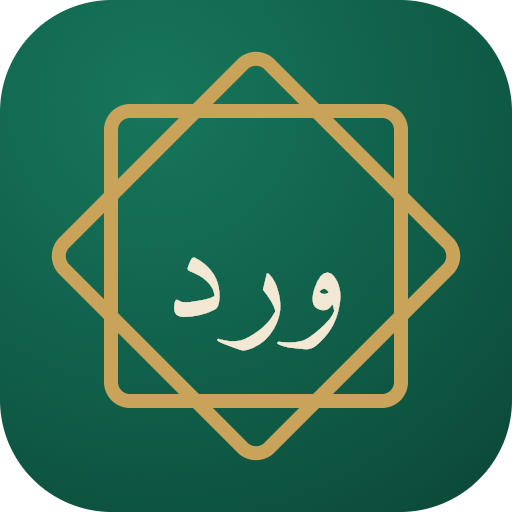
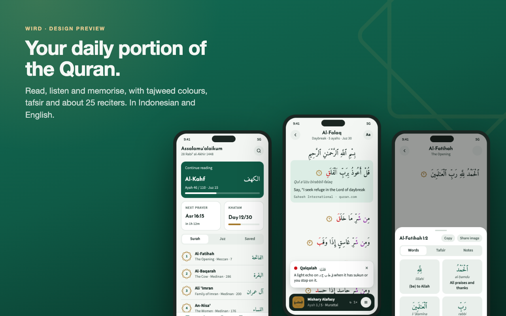
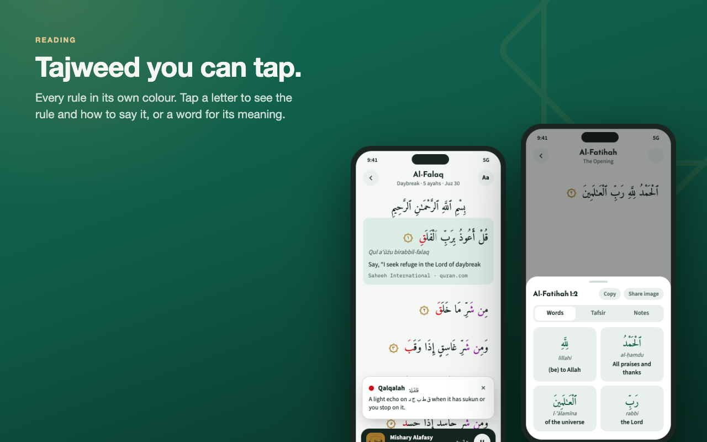
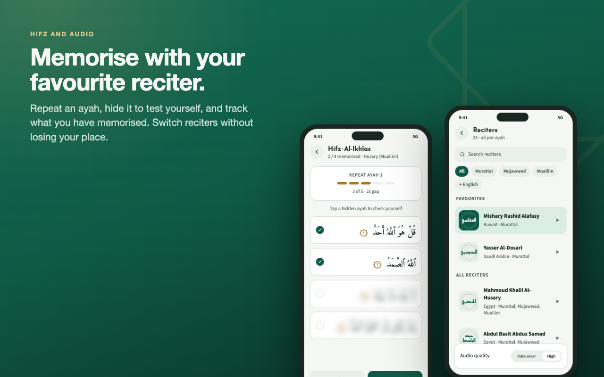
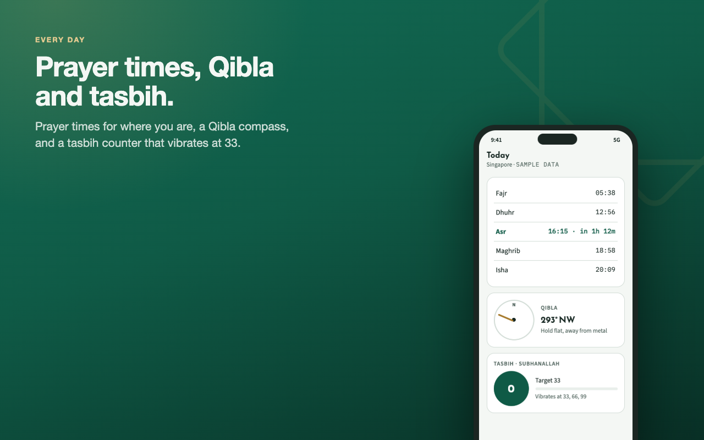

<p align="center">
  
</p>

<h1 align="center">Wird</h1>

<p align="center">
  <strong>Your daily portion of the Quran.</strong><br>
  A Quran app for iOS and Android: read by Surah or page by page with tajweed colours, listen to 27 reciters,
  keep a daily habit with a Khatam plan and Hifz practice, and have prayer times, adhkar and a Qibla compass
  in the same place. In Indonesian and English. No account, no ads, no tracking.
</p>

<p align="center">
  <a href="https://heyhadi.github.io/wird/">Website</a> ·
  <a href="https://github.com/heyhadi/wird/releases/latest">Download for Android</a> ·
  <a href="#what-it-does">Features</a> ·
  <a href="#how-it-works">How it works</a> ·
  <a href="#development">Development</a> ·
  <a href="#coming-next">Coming next</a> ·
  <a href="ROADMAP.md">Roadmap</a>
</p>



<p align="center"><sub>Design preview of the redesign in progress. What the app does today is listed under <a href="#what-it-does">What it does</a>.</sub></p>

*Wird* (وِرْد) is the portion of Quran a person keeps up every day. This is a personal project.

## What it does

|  |  |
|---|---|
| **Read all 114 Surahs.** Arabic in the Amiri typeface with the translation under every ayah: Kemenag in Indonesian, or one of six English editions with tappable footnotes. Transliteration is on by default, and the Arabic size is yours to set. | **Mushaf page mode.** All 604 pages of the Madani mushaf: justified lines, the Surah title plate and bismillah, ayah-end circles, tajweed colours, swipe right to turn the page, jump by page or Surah. Two pages side by side when a tablet is turned sideways. |
| **Tajweed you can tap.** Every rule in its own colour, in the reader and on the mushaf page. Tap a letter to see the rule and how to say it, or open the learning screen for a real example of each rule that you can hear. | **Word by word.** Tap any ayah for each word's transliteration and meaning, and hear the word. |
| **Tafsir.** Eight editions: Kemenag, Ibn Kathir, Ma'arif al-Qur'an, Tazkirul Quran, Muyassar, As-Sa'di, At-Tabari and Al-Qurtubi. | **27 reciters.** Per-ayah audio with a mini-player that keeps going while you browse. Repeat, loop, speed, sleep timer, lock-screen controls. The next ayahs are fetched ahead, so playback flows. |
| **Listen offline, or save data.** Download a Surah to hear it without a connection, or switch on the data saver for smaller files (half the size or less) where a reciter has them. A size-limited cache keeps what you have streamed; see and clear it in Settings. | **Today.** One calm screen: the next prayer, your reading goal and streak, the ayah of the day, your adhkar and quick links to Hifz and tasbih. |
| **Khatam planner.** Finish the Quran in 30 to 180 days, with a daily goal, a streak and a map of the 30 Juz. Pages you read in the mushaf count too. | **Hifz mode.** Repeat an ayah or range, hide the text and tap to check yourself, practise with Husary's slow teaching recitation, and mark ayahs memorized. |
| **Prayer times and Ramadan.** By location with MUIS, Kemenag, JAKIM and five other methods, a countdown to the next prayer, reminders, and a Qibla compass. In Ramadan: the day, a countdown to imsak and iftar, and suhoor and iftar reminders. | **Adhkar, dua, Asmaul Husna and tasbih.** Morning, evening and after-prayer adhkar with counters that start again each day, everyday dua with hadith sources, the 99 names, and a counter that vibrates at 33, 66 and 99. |
| **Notes, collections and search.** Write a note on any ayah, file bookmarks into coloured collections, and search by Surah name, meaning, number, Juz, or every ayah by meaning. | **Share an ayah** as an image card or as text. |
| **Indonesian and English**, light and dark (dark by default). Surahs you have read open again without a connection. | **Built for tablets too.** On a wide screen the app stays a centred reading column, sheets keep a sensible width, and tablets can turn to landscape (phones stay upright). |
| **Feedback.** Send feedback by email or open a GitHub issue from Settings; the report carries only the app version, phone system and language. | **Accessible text.** The text follows the phone's font size, with limits so layouts hold at large sizes. |

## How it works

**Data.** Quran text, translation, tafsir and per-ayah audio come from the [equran.id](https://equran.id) v2 API.
Screens never see the raw responses: `services/mappers.ts` turns them into the app's own types
(`services/types.ts`), so a change in the API is fixed in one place. Requests go through a small
`fetch` wrapper with a timeout and typed errors (`services/http.ts`).

**Offline.** Data is fetched with TanStack Query. Quran text and tafsir never change, so cached
entries never go stale, and the whole query cache is saved to MMKV with the sync persister. A Surah
opened once opens again without a network.

**Saved state.** Bookmarks, the last-read position and settings are small zustand stores saved to
MMKV (`store/`). A bookmark is keyed by Surah *and* ayah (`2:255`), so ayah 5 of one Surah is never
confused with ayah 5 of another.

**Audio.** One `expo-audio` player serves the whole app (`store/audioPlayer.ts`). When an ayah
finishes, the player reads the queue and position from the store at that moment, rather than from a
closure captured when playback started, so auto-advance always moves to the right ayah. Leaving a
Surah stops playback.

**Jumping to an ayah.** Bookmarks and Continue reading open `/surah/[id]?ayah=N`. Ayah cards have
different heights, so the list can't always scroll to a row it hasn't measured yet; when that
happens it jumps close by estimate and retries.

**Mushaf pages.** quran.com's per-word data gives every word its line (1 to 15) on its page
(`services/mushaf.ts`). The Surah title and bismillah lines are not in the data, so they are worked out from
where a Surah's first ayah falls on the page. Lines are justified by measuring the words and spreading them
across the width; a line that is too wide is shrunk to fit, and a short last line stays centred
(`components/MushafPageView.tsx`). `services/mushafLayout.ts` decides between one page and a two-page spread
from the screen size. Pages are fetched when first opened and saved like everything else.

**Tajweed on Android.** Android draws every coloured run of a nested `<Text>` on its own, so letters lose their
connection and vowel marks float away from their letters at each colour boundary (iOS draws across runs).
`shapeSafe` in `services/tajweed.ts` re-cuts the runs so a letter and its marks stay together and adds a
zero-width joiner where two runs meet in a joined word. The tajweed markup nests rules, so it is read with a
small stack instead of a regular expression.

**Audio cache.** While an ayah plays, the next two are downloaded into the cache folder
(`services/audioCache.ts`), written under a temporary name and renamed when whole so a half file is never
played. The cache stays under 150 MB, oldest files first; a Surah you downloaded on purpose is never touched.
Playback prefers a downloaded Surah, then a cached copy, then streams.

**Tablets.** `components/AppColumn.tsx` keeps the whole app in a centred column on wide screens, except the
mushaf, which lays out its own pages. Every orientation is allowed in `app.json` and phones are locked to
portrait at startup (`constants/device.ts`).

**Qibla.** The bearing to the Kaaba is the initial great-circle bearing from your position
(`services/qibla.ts`, tested against known values for Singapore, Jakarta, London and New York). The
heading comes from the operating system's compass through `expo-location`, which already corrects
for tilt and magnetic declination, so no raw magnetometer maths is needed.

## Install on Android

Download `wird-android.apk` from the [latest release](https://github.com/heyhadi/wird/releases/latest), open it on your phone, and allow your browser to install it when Android asks (turn that permission off again afterwards). It needs Android 7 or newer on a 64-bit phone. It is a preview build, not on the Play Store yet, and only the releases page is an official place to get it. The steps and the checksum are on the release and on the [website](https://heyhadi.github.io/wird/#get).

## Development

Wird uses native modules (MMKV, `expo-audio`, view-shot and others), so it runs as an Expo **development
build**, not in Expo Go.

```sh
npm install
npm run ios                       # build and open in the iOS Simulator (needs Xcode)
npm run android                   # build and open on an Android emulator or device (needs Android Studio)
npx expo start --dev-client       # after the first build: start Metro and live-reload as usual
npm run test:ci                   # unit tests (Jest)
npm run typecheck
npm run build:android:preview     # a sealed Android APK, built in the cloud with EAS
```

**Testing on a real Android phone without Android Studio.** Build the development app once with
`npx eas-cli build --platform android --profile development`, install the APK, then run
`npx expo start --dev-client` on your computer and enter its address (for example
`http://192.168.1.54:8081`) in the app, with both on the same trusted Wi-Fi. After that, code changes
reload in seconds and no new APK is needed. Builds are arm64-only, which keeps the APK to a quarter of the
size, and the version code rises with each build. Settings shows the build you are running, for example
`1.0.0 (87defc1)`.

- Stack: Expo SDK 57, React Native 0.86, React 19, Expo Router, TanStack Query, zustand, MMKV,
  react-native-paper.
- `ios/` and `android/` are generated from `app.json` by `expo prebuild` and are not committed.
- Tests cover the API mappers, the tajweed (including nested rules and the Android re-cutting) and rich-text parsers, search, Qibla maths, prayer times and time zones, reminder planning including Ramadan, khatam maths, the mushaf page mapping and layout, the audio cache and player, and every store. Fixtures are trimmed copies of real API responses
  (`services/__tests__/fixtures/`).
- `node scripts/readme-images.mjs` regenerates the README images from the design mockups in
  `docs/quranrn-plan.html`, and `node scripts/app-icons.mjs` regenerates the app icon, splash and
  notification icon, both using your installed Chrome.
- Store listing copy in English and Indonesian: [docs/store-listing.md](docs/store-listing.md).

## Coming next

Phases 1 to 9 of [ROADMAP.md](ROADMAP.md) are built. Still to do:

1. Home-screen widgets (they need native work on both platforms)
2. Store screenshots in English and Indonesian
3. Checks on real devices: reminders, lock-screen audio, share-as-image, and an iPad turned sideways
4. A softer look for the Adhkar and dua cards, to match the rest







These images are design mockups; the Quran text and tajweed markup in them are real (quran.com), and the
prayer times are sample data. The app itself now follows them closely.

## Known limits

- Indonesian doa come from equran.id (227); the English dua list is the smaller bundled set (46). The Asmaul Husna meanings are in English.
- A Surah or a mushaf page needs a connection the first time it is opened, and tajweed colours, English translations,
  word-by-word and the other tafsirs need one the first time each is used.
- The coloured tajweed text spells a few marks in a slightly different but equivalent way from the plain text, so a word can look a little different with colours on or off. That is quran.com's data.
- On Android the coloured area now covers a whole letter with its marks, not only the mark, so the text draws correctly.
- Background audio, lock-screen controls and reminders are set up but still need to be checked on a real phone. The audio player card on the lock screen may still use the app icon.
- The landscape layout and the mushaf spread have not been checked on a real tablet.
- Ayah search by meaning always needs a connection.
- The Qibla compass needs a real device; simulators have no compass.

## Credits

- Quran text, Indonesian translation, Kemenag tafsir and doa via [equran.id](https://equran.id).
- Adhkar and English dua from [fitrahive/dua-dhikr](https://github.com/fitrahive/dua-dhikr) (MIT), bundled in `constants/adhkar/`.
- English translations, tajweed text, word-by-word, the mushaf page line data, other tafsirs and ayah search via [quran.com](https://quran.com); more recitations from [everyayah.com](https://everyayah.com); prayer times and Asmaul Husna from [aladhan.com](https://aladhan.com).
- [Amiri](https://github.com/aliftype/amiri) typeface by Khaled Hosny, [Reem Kufi](https://github.com/aliftype/reem-kufi) and [Source Sans 3](https://github.com/adobe-fonts/source-sans), all under the SIL Open Font License.
- Adhan audio (`assets/audio/adhan.mp3`) downloaded from [islamcan.com/audio/adhan](https://www.islamcan.com/audio/adhan/) (free download).
- Letter name audio for Learn to Read (`assets/audio/learn/names/`) by Ruaa GHAREEB on [Wikimedia Commons](https://commons.wikimedia.org/w/index.php?title=Special:ListFiles/Ruaa_GHAREEB), [CC BY-SA 4.0](https://creativecommons.org/licenses/by-sa/4.0/); levelled and converted to AAC. These clips stay under CC BY-SA 4.0 (see the folder's `LICENSE.md`).

---

© 2026 Munawirul Hadi. All rights reserved. The source is public to read; it is not licensed for reuse.
